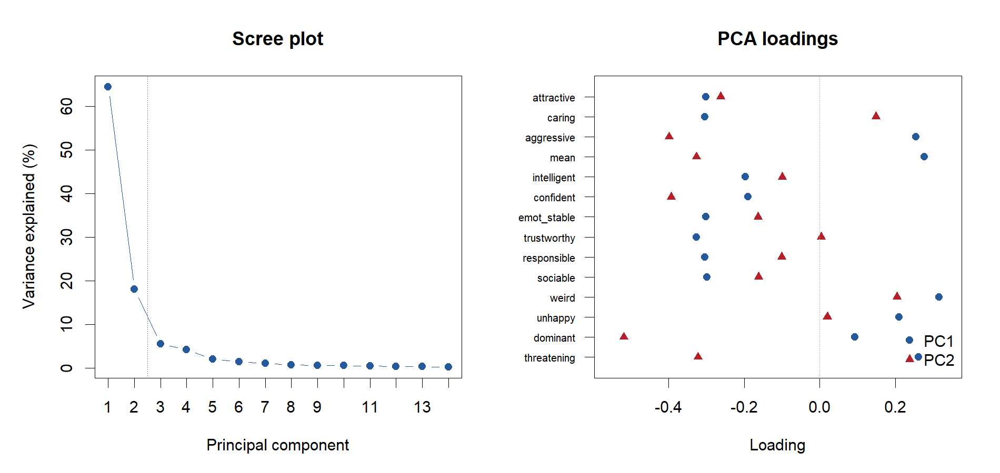
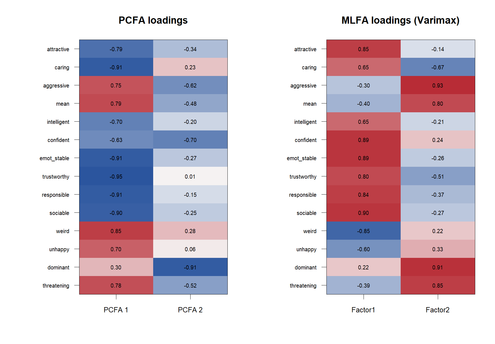
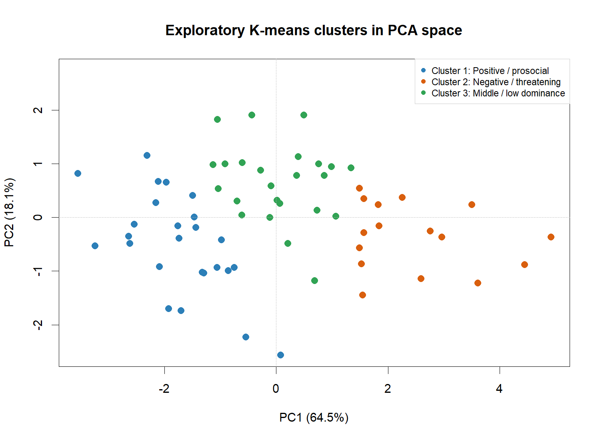
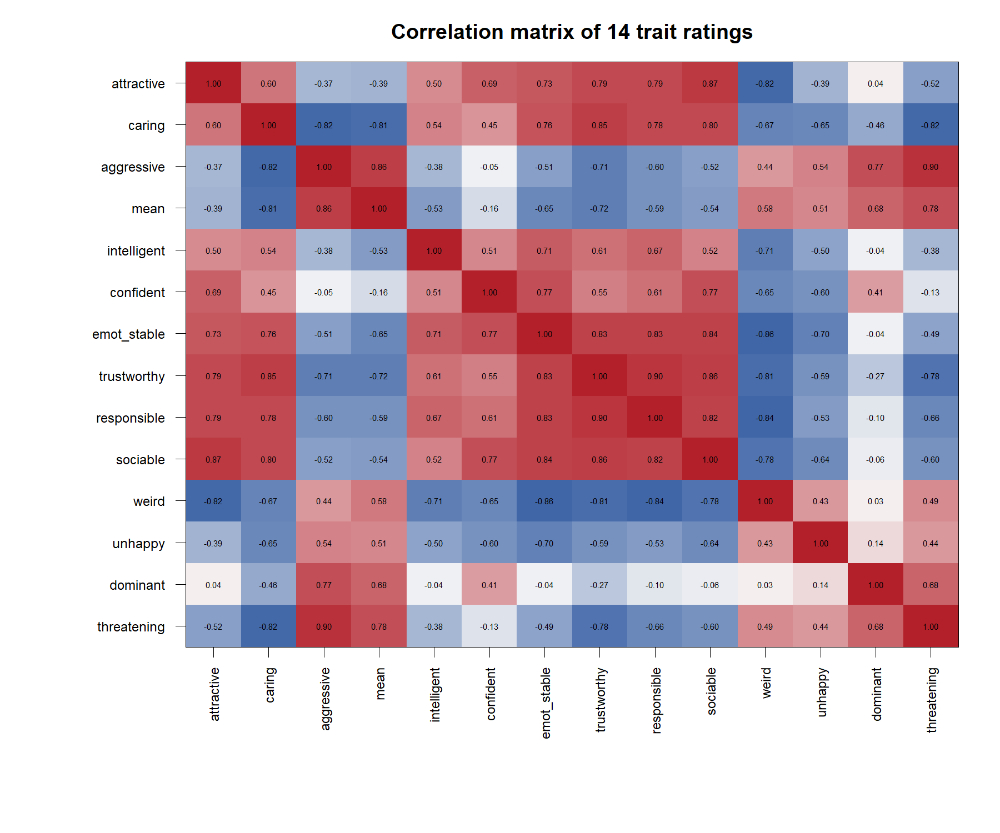

# Face Impression Multivariate Analysis

## 얼굴 인상 평가 데이터의 다변량 구조 분석

Oosterhof & Todorov의 얼굴 인상 연구에서 사용된 사회적 인상 평정 데이터를 바탕으로, **PCA, Factor Analysis, Clustering**을 적용해 얼굴 인상의 잠재 구조와 탐색적 유형을 비교한 프로젝트입니다.

심리학 전공에서 다룬 얼굴 인상 연구문제를 통계학 복수전공의 다변량 분석 프로젝트로 확장했습니다. 동일한 14개 평정 자료에 PCA, 요인분석과 군집분석을 적용해 두 축의 구조가 방법에 따라 어떻게 달라지는지와 얼굴 자극의 군집 패턴을 비교했습니다.

> 이 분석의 관측 단위는 평가 참가자 개인이 아니라 **여러 참가자의 평정을 평균한 얼굴 자극 66개**입니다. 결과는 얼굴 자극에 대한 평균적 인상 구조를 설명하며, 개인의 성격이나 일반 인구의 심리 특성을 뜻하지 않습니다.

## Analysis Questions

- 14개 사회적 인상 평정은 몇 개의 주요 차원으로 요약되는가?
- PCA와 Factor Analysis에서 유사한 구조가 나타나는가?
- 얼굴 자극들은 잠재 차원상에서 탐색적 군집을 형성하는가?
- 군집과 자극 성별의 관계는 같은 자료 안에서 어떤 보조적 패턴을 보이는가?

## Dataset

- **분석 단위:** 평균화된 중립 표정 얼굴 자극 66개
- **변수:** attractive, caring, aggressive, mean, intelligent, confident, emotionally stable, trustworthy, responsible, sociable, weird, unhappy, dominant, threatening의 14개 평정
- **값의 의미:** 참가자별 표준화 평정을 얼굴 자극별로 평균한 값
- **원 연구:** Oosterhof & Todorov (2008), *The functional basis of face evaluation*
- **원 자극:** Karolinska Directed Emotional Faces (KDEF)

KDEF 얼굴 사진은 저작권자가 재배포를 제한합니다. 평정 데이터의 별도 재배포 조건도 명시적으로 확인되지 않아 이 저장소에는 사진과 raw ratings를 포함하지 않았습니다. 공식 배포 페이지에서 데이터를 받은 뒤 `data/Karolinska_14trait_judgmentswithlabels.xls`로 저장하면 분석을 실행할 수 있습니다. 자세한 출처와 획득 절차는 [`data/README.md`](data/README.md)에 정리했습니다.

## Analysis Flow

연구문제와 분석 단위 확인 → 기술통계·상관구조 탐색 → PCA 차원 축소 → PCFA·MLFA 비교 → Hierarchical Clustering·K-means → 심리학적 해석 → 결과의 적용 범위 검토

## PCA

원본 분석과 동일하게 공분산 기반 `prcomp()`를 적용했습니다. PC1은 **64.5%**, PC2는 **18.1%**를 설명했으며 두 축의 누적 설명력은 **82.5%**였습니다. PC1에는 trustworthy, caring, responsible, emotionally stable, sociable과 aggressive, mean, weird, threatening이 반대 방향으로 놓였습니다. PC2에는 dominant가 크게 기여했고 aggressive, threatening, confident도 관련되었습니다.

이 구조는 기존 연구의 valence/trustworthiness와 dominance라는 2차원 해석과 유사합니다. 다만 이 프로젝트는 연구를 그대로 복제한 것이 아니라, 해당 구조를 참고해 Factor Analysis와 Clustering에서도 유사성이 유지되는지 탐색한 것입니다.



## Factor Analysis

상관행렬에 대한 **PCFA**의 첫 두 성분은 전체 표준화 분산의 **81.8%**를 설명했습니다. **MLFA with Varimax rotation**에서는 Factor 1이 긍정적·사회적 평정과, Factor 2가 지배적·위협적 평정과 주로 연결되었고 두 요인의 SS loadings 합은 전체 변수 분산의 **79.4%**였습니다.

PCA와 두 요인분석은 큰 방향에서는 비슷한 이중 구조를 보였습니다. 그러나 2-factor MLFA의 exact-fit test는 유의했습니다(χ²(64) = 257.88, p < .001). 따라서 높은 설명량이나 작은 잔차 일부만으로 2-factor model의 적합성이 충분하다고 단정하지 않습니다.



## Cluster Analysis

기존 분석은 single, complete, average, Ward linkage를 비교하고 `NbClust` 다수결 결과에 따라 3개 군집을 사용했습니다. 공개용 K-means에는 재현성을 위해 `set.seed(2025)`를 명시했습니다.

- Cluster 1 (n = 25): 상대적으로 긍정적·친사회적 평정이 높은 자극
- Cluster 2 (n = 17): 부정적·위협적 평정이 높은 자극
- Cluster 3 (n = 24): 다수 평정이 평균에 가깝고 dominance가 상대적으로 낮은 자극

군집 번호와 이름은 데이터에서 얻은 상대적 패턴을 설명하는 편의적 표지입니다. silhouette 또는 bootstrap stability 검증을 수행하지 않았으므로 군집 결과는 탐색적 패턴으로 제시합니다.



## Main Findings

1. 14개 평정은 두 개의 큰 축으로 상당 부분 요약되며, 첫 두 PCA 성분의 누적 설명력은 82.5%였습니다.
2. PCFA와 Varimax-rotated MLFA도 긍정성·친사회성과 지배성·위협성에 관련된 구조를 보였습니다.
3. 3-cluster K-means는 긍정·친사회적, 부정·위협적, 중간·저지배 패턴을 탐색적으로 구분했습니다.
4. 고정 seed 군집과 자극 성별의 연관은 유의하지 않았습니다(χ²(2) = 1.70, p = .428). 이는 같은 표본에서 군집을 생성한 뒤 확인한 보조 분석 결과입니다.



## Interpretation

분석 결과는 얼굴 자극에 대한 여러 사회적 평정이 완전히 독립적이지 않고, 접근·회피와 연관된 긍정성 및 지배성·위협성에 가까운 축을 공유한다는 해석을 지지합니다. 그러나 평정값은 얼굴만 보고 형성된 평균 인상입니다. 실제 성격, 능력, 의도 또는 성별 집단의 심리 차이를 측정한 값이 아닙니다.

## What I Did

- 기존 심리학 연구의 질문과 얼굴 자극 단위의 데이터 구조를 확인했습니다.
- 목적에 따라 PCA, PCFA, MLFA, Hierarchical Clustering, K-means를 연결했습니다.
- 차원 축소와 잠재요인 모형의 공통점과 차이를 비교했습니다.
- 통계 구조를 심리학적 의미와 연결하되, 얼굴 인상과 실제 특성을 구분했습니다.
- seed 미설정, 군집 안정성, 요인 수 결정, 성별 해석, exact-fit 결과를 재검토했습니다.

## Reproducibility

```r
# 저장소 루트에서
renv::restore()
rmarkdown::render(
  "analysis/face_impression_analysis.Rmd",
  output_file = "face_impression_analysis.html"
)
```

필수 raw data 파일은 라이선스 확인 문제로 저장소에 포함하지 않았습니다. 데이터 파일을 공식 출처에서 내려받아 지정 경로에 둔 환경에서는 전체 Rmd가 렌더됩니다. 본 재구성에서는 R 4.6.1과 lockfile 환경으로 HTML 및 4개 대표 Figure 생성을 확인했습니다.

## Limitations

- 관측 단위가 평균화된 얼굴 자극 66개로 작습니다.
- 참가자 수준 자료가 아니라 평균 평정값을 사용해 개인차와 평정자 불확실성을 분석할 수 없습니다.
- PCA는 원 분석을 보존하기 위해 공분산 행렬을 사용했으므로 표준편차가 큰 평정 변수가 더 큰 영향을 받을 수 있습니다.
- 요인 수는 scree plot과 설명력, 기존 연구 구조를 바탕으로 정했습니다. parallel analysis, KMO, Bartlett 검정은 수행하지 않았습니다.
- Mardia 검정에서 정규성을 기각할 충분한 근거가 없었지만, 이것이 정규성의 확정을 뜻하지는 않습니다.
- 2-factor MLFA exact-fit test는 모형의 불완전성을 보여줍니다.
- 군집 안정성에 대한 silhouette 또는 bootstrap 검증이 없습니다.
- 군집과 성별의 관계는 같은 자료에서 생성·검정한 탐색적 보조 결과입니다.

## References

- Oosterhof, N. N., & Todorov, A. (2008). The functional basis of face evaluation. *PNAS, 105*(32), 11087–11092. https://doi.org/10.1073/pnas.0805664105
- Lundqvist, D., Flykt, A., & Öhman, A. (1998). *The Karolinska Directed Emotional Faces (KDEF)*.
- Todorov, A., & Oh, D. (2021). The structure and perceptual basis of social judgments from faces. *Advances in Experimental Social Psychology, 63*, 189–246.

## License

코드와 자체 작성 문서는 [MIT License](LICENSE)를 따릅니다. KDEF 자극과 외부 데이터에는 적용되지 않습니다.
